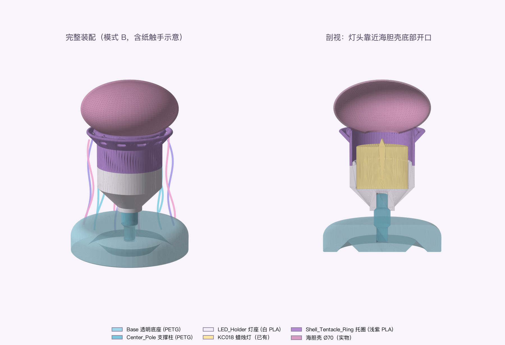

# Iris Jellyfish Lamp V6 · 海胆水母小夜灯

Iris 设计的手工小夜灯：真实海胆壳当水母头，KC018 电子蜡烛灯从下方照亮，彩纸触手挂在海胆壳下面。整灯“悬浮”在透明底座上。



## 文件

| 文件 | 说明 |
|---|---|
| `Iris_Jellyfish_V6.scad` | 完整参数化 OpenSCAD 源文件（所有零件、两种模式、示意装配） |
| `STL/Base.stl` | Part 1 透明底座 |
| `STL/Center_Pole.stl` | Part 2 中央支撑柱 |
| `STL/LED_Holder.stl` | Part 3 KC018 灯座（模式 B，默认） |
| `STL/Shell_Tentacle_Ring.stl` | Part 4 海胆托圈 + 触手挂环（模式 B，默认） |
| `STL/Mode_A/*.stl` | 模式 A 的灯座和托圈（海胆开口 ≥ 41 mm 时用） |
| `Iris_Jellyfish_V6_plate.3mf` | 四个零件摆在一块 A1 打印板上的通用 3MF（可选；材料需在 Bambu Studio 里手动指定） |
| `Preview/assembled.png` `exploded.png` `dimensions.png` | 装配图、分解图、剖面尺寸图（`*_modeA.png` 为模式 A） |
| `Preview/verify_report.json` | 几何检查完整结果 |
| `build.sh` / `tools/` | 重新生成 STL、检查、渲染、3MF 的脚本 |

## 结构（从下到上）

透明底座 → 短支撑柱 → LED 灯座（灯杯）→ KC018 → 托圈（套在灯座定位环上）→ 海胆壳。

- **承重路径**：海胆壳只压在托圈的圆弧唇上；托圈坐在灯座的台阶上；蜡烛灯不承担海胆壳任何重量。
- **灯的位置**：灯头朝上；模式 B 灯顶离海胆壳最低点约 2–3.5 mm；模式 A 灯头伸进壳内约 15 mm。灯顶上方没有任何打印件。
- **可拆**：所有连接都是插接/搁置，没有胶和螺丝。

### 两种 LED 模式（共用底座和支撑柱）

| | 模式 B（默认） | 模式 A |
|---|---|---|
| 适用 | 海胆底部开口 < 41 mm | 开口 ≥ 41 mm（KC018 Ø37.2 + 余量） |
| 灯的位置 | 灯在壳下方，灯头贴近开口 | 灯穿过开口，上部约 15 mm 进入壳内 |
| 换零件 | `LED_Holder.stl` + `Shell_Tentacle_Ring.stl` | `Mode_A/` 下两个文件 |

两种模式下托圈接触面高度相同，所以底座和支撑柱不用换。灯不可能从上方掉进壳里，因为它一直坐在灯杯底上。

## 关键尺寸（模式 B，模型计算值）

见 `Preview/dimensions.png`。

| 项目 | 数值 |
|---|---|
| 底座 | Ø86 × 20，顶部 R9 圆角 |
| 支撑柱 | Ø12，本体 10.8 mm，两端 Ø8×10 插销 + 45° 锥肩，总长 34.8 mm |
| 触手展示空间（底座顶 → 海胆壳最低点） | 设计 65 mm，示意壳实测 66.5 mm |
| 触手挂孔高度 → 底座顶 | 约 65 mm |
| 托圈外径 / 接触唇直径 | Ø62 / 约 Ø50 |
| 整灯高度 | 约 125 mm |

**关于 62 mm 支撑柱**：灯座 + 竖放的 KC018 已经占掉海胆壳下方约 52 mm。如果支撑柱本体用 62 mm，触手空间会变成约 117 mm，远超 50–70 mm 的目标，重心也更高。所以这一版改为由 `tentacle_space` 反算柱长（默认 65 mm → 柱本体 10.8 mm）。想要更高的“悬浮感”时调大 `tentacle_space` 即可，柱子会自动变长。

## 打印（Bambu Studio）

已在本机用 Bambu Studio CLI 对四个 STL 实际切片：**A1 0.4 喷嘴，0.20mm Standard，3 层壁，15% Gyroid，关闭支撑，纹理 PEI 板**。全部成功，没有警告。

| 零件 | 材料 | 打印方向 | 切片估算 | 备注 |
|---|---|---|---|---|
| Base | 透明 PETG | 平底朝下（STL 原方向） | 37.4 g · 约 69 min | 底部环形配重槽是 45° 屋顶，免支撑 |
| Center_Pole | 透明 PETG | 竖直站立（STL 原方向） | 1.9 g · 约 22 min | 落脚面小，**开 5 mm 外 brim** |
| LED_Holder | 白色 PLA | 小端朝下（STL 原方向） | 16.0 g · 约 29 min | 45° 锥免支撑；插孔顶是 Ø8.4 小桥接；**建议开 brim** |
| Shell_Tentacle_Ring | 浅紫 PLA | 套筒端朝下（STL 原方向） | 13.5 g · 约 28 min | 裙边正好 45°；触手孔垂直于裙面，孔口有圆角 |

推荐参数：

- 层高 0.20 mm，3 层壁，顶/底 4 层，15% Gyroid。
- 支撑：**关**。所有悬空 ≤45°，唯一的桥接是灯座插孔顶（Ø8.4）。
- 透明 PETG：想更透可用 4 层壁 + 0% 填充（底座会更轻，建议在配重槽里放硬币）。降低外壁速度会更清透。
- PETG 用纹理 PEI 板或在光滑板上涂胶水，防止粘得太牢。

## 装配顺序

1. **试配支撑柱**：把支撑柱一端插进底座。插孔里有 3 条压缩筋，有一点阻力是正常的（设计过盈 0.05 mm）。插到 45° 锥肩贴住为止，不要用力砸。两端插销一样，不分正反。
2. **装灯座**：把灯座插孔对准支撑柱上端压下去。
3. **（可选）配重**：底座翻过来，在环形槽里放硬币或钢珠，用热熔胶固定。不放也能用。
4. **放灯**：KC018 灯头朝上放进灯杯。杯内 3 条软定位筋只做居中，单边约 0.1 mm 间隙，不需要用力。
5. **挂触手**：在桌面上先给托圈挂好触手。纸条（≤6 mm 宽）从下往上穿过长孔，折过来用双面胶贴在裙边内侧；丝带或线（≤2.5 mm）穿过后打结。共 12 个孔。
6. **套托圈**：把托圈从上方套在灯座顶部 3 mm 的定位环上，坐在台阶上。
7. **放海胆壳**：开口朝下轻放在托圈的圆弧唇上，它会自己居中。

**拆卸和换电池**：拿起海胆壳 → 向上拿起托圈（触手跟着托圈走）→ 捏住露出灯杯约 17 mm 的灯身把 KC018 取出 → 操作底部开关或换电池。

## 软件几何检查结果

由 `tools/verify.py` 生成，详见 `Preview/verify_report.json`。这些只是对模型的检查，**不代表实物装配已经通过**。

| # | 检查项 | 结果 |
|---|---|---|
| 1 | 四个 STL 封闭实体 | 全部 watertight、法向一致、单一实体 |
| 2 | 支撑柱 ↔ 底座 | 单边间隙 0.2 mm，45° 锥肩定位；3 条筋过盈 0.05 mm（干涉体积 0.35 mm³，属设计值） |
| 3 | 支撑柱 ↔ 灯座 | 同上（0.6 mm³ 筋过盈）；插销到底还留 0.8 mm |
| 4 | 灯座 ↔ 托圈 | 无干涉；套筒单边间隙 0.3 mm |
| 5 | 蜡烛灯取出路径 | 竖直向上扫掠 80 mm，与灯座、托圈零干涉；灯与定位筋最小间隙 0.11 mm |
| 6 | 海胆壳独立放置 | 示意壳（Ø70×40 扁球、开口 Ø24）只碰托圈唇；裙边外缘离壳 ≥ 3.98 mm；灯顶离壳 ≥ 3.5 mm |
| 7 | 触手孔 | 12 个孔都能通过 2.4×6.4 mm 通道体；3.4×7.4 mm 通道体会被挡住（证明孔约 3×7 mm） |
| 8 | 圆滑边缘 | 接触唇 R2；裙边外缘 R1.1；孔口 0.6 mm 圆角；底座顶 R9；托圈无尖角 |
| 9 | 倾倒 | 估算总重约 99 g（灯 30 g、壳 15 g 为假设值），重心约 52 mm 高，静态倾倒角约 39°；放 40 g 配重后约 48° |
| 10 | Bambu FDM | Bambu Studio CLI 切片全部成功，无支撑、无警告 |
| — | LED 光路 | 灯顶上方 Ø37.2 光路柱内没有任何打印件 |

## ⚠️ 需要实物测量或试装（待验证）

| 项目 | 当前假设 | 怎么改 |
|---|---|---|
| 海胆壳底部开口直径 | 未知，默认按模式 B | 开口 ≥ 41 mm 用模式 A（`mode="A"`） |
| 海胆壳最低点比托圈接触面低多少 | `shell_sag = 5.5`（偏保守；示意壳约 4.0） | 壳放在托圈上，从侧面量。量出来更小时灯离壳会更远一点，可调小 |
| KC018 外径/高度 | 37.2 / 36.6 | `led_d` / `led_h`；**灯头若有凸起要计入高度** |
| KC018 开关位置和尺寸 | 假设在底部，取出后操作 | 如果在侧面，需要在灯杯开缺口 |
| 灯杯松紧 | `led_fit = 0.4`，筋凸出 0.3 | 太松调大 `led_rib_h`，太紧调大 `led_fit` |
| 插销松紧（PETG 收缩因机器而异） | `peg_fit = 0.2`，`rib_protrude = 0.25` | 太紧时 `rib_protrude` 改成 0.2；太松改成 0.3 |
| 托圈唇与海胆壳的实际接触 | 接触圆直径约 50 mm | 壳底如果很平，可以把 `ring_od` 加大到 64，或调整 `lip_r` |
| 灯和壳的实际重量 | 30 g / 15 g | 影响倾倒角，结果偏保守 |

建议先只打印托圈和灯座（约 1 小时），把海胆壳和 KC018 放上去试一下，确认后再打印 PETG 底座。

## 修改参数

在 OpenSCAD 里打开 `.scad`，用右侧 Customizer 改，或者命令行：

```bash
# 改触手空间为 70 mm，重新生成全部 STL
openscad --backend=manifold --export-format binstl -o STL/Center_Pole.stl -D 'part="pole"' -D 'tentacle_space=70' Iris_Jellyfish_V6.scad
```

常用参数：`tentacle_space`（触手空间）、`mode`（A/B）、`shell_sag`、`led_d`/`led_h`、`led_fit`、`peg_fit`、`ring_od`、`slot_n`（10–12）、`slot_w`/`slot_l`（孔尺寸）、`weight_groove`。

**注意**：改了 `shell_sag`、`led_h`、`led_gap` 后，支撑柱、灯座、托圈都会一起变，三个都要重新打印（底座不用）。

## 重新生成

```bash
./build.sh                       # 生成全部 STL
python tools/verify.py           # 几何检查 → Preview/verify_report.json
python tools/render.py B         # 渲染预览（A 为模式 A）
python tools/make_3mf.py         # 可选：打印板 3MF
```

Python 依赖：`trimesh manifold3d numpy scipy rtree shapely matplotlib lxml`。

OpenSCAD：Homebrew 的 `openscad` cask 已于 2026-09-01 停用（没有通过 Gatekeeper 检查），请用：

```bash
brew install --cask openscad@snapshot
```
